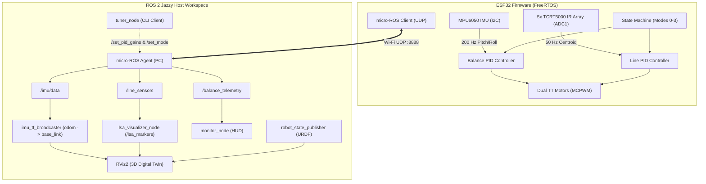

<p align="center">
  <h1 align="center"> WALL-E for ROS 2 </h1>
  <p align="center">
    <strong>Dual-Mode Autonomous Self-Balancing & Line-Tracking Mobile Robot with ROS 2 Jazzy & micro-ROS</strong>
    <br />
    <br />
    <a href="https://github.com/Siddharth-33/WALL-E-for-ROS2/releases">Watch Demos</a>
    ·
    <a href="#getting-started">Getting Started</a>
    ·
    <a href="#system-architecture">Architecture</a>
    ·
    <a href="#live-parameter-tuning-interactive-cli">Tuning Guide</a>
  </p>
</p>

<p align="center">
  <a href="https://docs.ros.org/en/jazzy/"></a>
  <a href="https://idf.espressif.com/"></a>
  <a href="https://micro.ros.org/"></a>
  <a href="https://github.com/SRA-VJTI"></a>
  <a href="LICENSE"></a>
</p>

---

## About the Project

**WALL-E for ROS 2** is a modular educational and research robotics platform developed as an advanced evolution of the SRA-VJTI Wall-E robot. It bridges high-rate, deterministic embedded control (**FreeRTOS on ESP32**) directly with the modern **ROS 2 Jazzy** robotics ecosystem using a high-throughput **micro-ROS UDP** wireless transport.

The brain of the robot is an **ESP32 microcontroller** paired with the **custom-made SRA development board**, controlling a dual-mode mobility platform:
1. **Self-Balancing Inverted Pendulum Mode**: Two-wheel dynamic balance utilizing closed-loop discrete-time PID feedback from an MPU6050 6-DOF IMU sampled at 200 Hz with complementary angle filtering and safety cutoffs.
2. **Autonomous Line-Following Mode**: High-speed three-wheel differential drive line navigation using a 5-channel TCRT5000 IR sensor array (LSA) on ADC1 with inverted reflectance mapping, weighted centroid error tracking, and differential velocity control.

Beyond embedded control, this repository integrates a complete host-side ROS 2 workspace featuring **zero-latency IMU TF synchronization**, an **interactive high-contrast 3D LSA digital twin in RViz2**, a **live terminal telemetry dashboard**, and an **interactive over-the-air (OTA) CLI tuner** for real-time PID gain updates without reflashing firmware.

---

## Video Demonstrations

<p align="center">

| <video height="350" src="https://github.com/Siddharth-33/WALL-E-for-ROS2/releases/download/v1.0.0/imu_tilt_demo.mp4" controls></video> | <video height="350" src="https://github.com/Siddharth-33/WALL-E-for-ROS2/releases/download/v1.0.0/self_balancing_demo.mp4" controls></video> | <video height="350" src="https://github.com/Siddharth-33/WALL-E-for-ROS2/releases/download/v1.0.0/line_following_demo.mp4" controls></video> |
:-------------------------:|:-------------------------:|:-------------------------:
**Zero-Latency IMU 3D Tilting**<br>[Watch / Download](https://github.com/Siddharth-33/WALL-E-for-ROS2/releases/download/v1.0.0/imu_tilt_demo.mp4) | **Closed-Loop Self-Balancing**<br>[Watch / Download](https://github.com/Siddharth-33/WALL-E-for-ROS2/releases/download/v1.0.0/self_balancing_demo.mp4) | **High-Speed Line Tracking**<br>[Watch / Download](https://github.com/Siddharth-33/WALL-E-for-ROS2/releases/download/v1.0.0/line_following_demo.mp4)

</p>

*All three demonstration videos are hosted on [GitHub Releases v1.0.0](https://github.com/Siddharth-33/WALL-E-for-ROS2/releases).*

---

## Technical Architecture

### 1. Embedded Control Architecture (ESP32 / FreeRTOS)
- **Deterministic Multi-Rate Scheduling**:
  - `balance_task` (**200 Hz** on Core 1): Computes discrete-time PID output from complementary-filtered MPU6050 pitch data and commands dual TT gearmotors via hardware MCPWM.
  - `line_sensor_task` (**50 Hz** on Core 1): Samples 5 phototransistors via 12-bit ADC1, normalizes reflectance, calculates weighted line centroid, and provides heading retention if the line is lost.
  - `state_machine_task` (**50 Hz** on Core 1): Manages mode switching (IDLE, BALANCE, LINE_FOLLOW, BOTH) with emergency tilt cutoffs.
  - `microros_spin_task` (**Core 0**): Asynchronous micro-ROS client streaming telemetry over Wi-Fi UDP.

### 2. Control Theory
- **Inverted Pendulum Self-Balancing (Mode 1)**:
  $$\text{error}(t) = \theta_{\text{target}} - \theta_{\text{pitch}}(t)$$
  $$u(t) = K_p \cdot e(t) + K_i \int e(t)\,dt + K_d \frac{de(t)}{dt}$$
  - Anti-windup clamping caps the integral state at $\pm 100.0$.
  - Physical center-of-gravity offset trim allows precise zero-velocity upright balance.
  - Safety cutoff terminates motor actuation if $|\theta_{\text{pitch}}| > 50^\circ$.

- **Differential Line Following (Mode 2)**:
  - TCRT5000 sensors return low ADC counts on white reflective surfaces and high counts on dark floors.
  - ADC readings are mapped to $0\text{--}1000$ and inverted ($1000 - \text{mapped}$) with a detection boundary of $820$.
  - Centroid position is computed with spatial weights $\{-5, -3, 1, 3, 5\}$:
    $$\text{pos} = \frac{\sum_{i=0}^4 w_i \cdot k_i - 1}{\sum_{i=0}^4 k_i}$$
  - Differential motor speeds:
    $$v_{\text{left}} = \text{clamp}(V_{\text{opt}} + \text{correction},\, V_{\text{min}},\, V_{\text{max}})$$
    $$v_{\text{right}} = \text{clamp}(V_{\text{opt}} - \text{correction},\, V_{\text{min}},\, V_{\text{max}})$$

### 3. ROS 2 Software Ecosystem (Host PC)
- **`imu_tf_broadcaster`**: Converts orientation quaternions from `/imu/data` into dynamic coordinate transforms (`odom -> base_link`) synchronized with host clock time for jitter-free RViz rendering.
- **`lsa_visualizer_node`**: High-contrast 3D marker generator displaying 5 distinct sensor pads in RViz (pure white when active, jet black when inactive) alongside a real-time ASCII HUD in the terminal.
- **`tuner_node`**: Interactive over-the-air CLI client that calls `/set_pid_gains` and `/set_mode` services, updating controller gains in under 100 ms without reflashing firmware.
- **`monitor_node`**: Telemetry monitor displaying pitch angle, battery level, duty cycles, and sensor status.

---

## System Architecture



---

## Hardware Specifications & Pinout

| Component | Hardware Model | ESP32 Pinout | Interface / Specs |
| :--- | :--- | :--- | :--- |
| **Mainboard** | SRA Board v4 | ESP32-WROOM-32D | Dual Core Xtensa LX6 @ 240 MHz |
| **IMU** | MPU6050 (6-DOF) | SDA: `GPIO 21`, SCL: `GPIO 22` | I2C Fast-Mode (400 kHz) |
| **Line Sensor Array** | 5x TCRT5000 Phototransistors | `GPIO 32, 35, 34, 39, 36` | ADC1 (12-bit, 11dB attenuation) |
| **Motor Driver** | Dual H-Bridge | AIN1/2, BIN1/2, PWMA/B | Hardware MCPWM @ 20 kHz |
| **Motors** | TT DC Gearmotors (1:48) | Left & Right Drive Axles | Differential Drive, 65mm Wheels |
| **Chassis** | Modular Acrylic / 3D Print | 100mm × 80mm × 60mm | Front Caster Attachment |
| **Power Supply** | 2S 7.4V Li-ion (2000 mAh) | Vin to Buck Regulators (5V/3.3V) | High Discharge |

---

## Repository Structure

```
WALL-E-for-ROS2/
├── README.md                           # Master Technical Documentation
├── .gitignore                          # Excludes all build artifacts & binaries
├── firmware/                           # ESP-IDF FreeRTOS Firmware
│   ├── CMakeLists.txt                  # Build configuration
│   ├── sdkconfig.defaults              # Default configuration
│   ├── sdkconfig                       # Active configuration
│   ├── app-colcon.meta                 # micro-ROS build profile
│   ├── main/
│   │   ├── main.c                      # Multi-rate FreeRTOS task orchestration
│   │   ├── balance_controller.h        # PID parameters, speed bounds, setpoint
│   │   ├── balance_controller.c        # Inverted pendulum & line tracking math
│   │   ├── walle_lsa.h / .c            # 5-channel ADC normalization & centroid
│   │   ├── microros_transport.h / .c   # micro-ROS telemetry & service servers
│   │   ├── imu_driver.h / .c           # MPU6050 sensor reading & filtering
│   │   ├── walle_motor.h / .c          # MCPWM motor control driver
│   │   ├── state_machine.h / .c        # Mode management logic
│   │   └── wifi_manager.h / .c         # Wi-Fi STA connection manager
│   └── components/                     # ESP-IDF Components (micro-ROS & SRA board)
└── ros2_ws/                            # Host ROS 2 Workspace
    └── src/
        ├── walle_interfaces/           # Custom message and service definitions
        │   ├── msg/LineSensorArray.msg # 5-channel ADC, normalized, centroid
        │   ├── msg/BalanceTelemetry.msg# Real-time state & telemetry
        │   ├── srv/SetPidGains.srv     # Dynamic PID tuning service
        │   └── srv/SetMode.srv         # Runtime mode switching service
        ├── walle_description/          # Robot URDF model & RViz configuration
        │   ├── urdf/walle.urdf.xacro   # Parametric URDF model with wheels & sensors
        │   ├── rviz/walle_view.rviz    # Preconfigured RViz layout
        │   └── launch/description.launch.py # Launches robot_state_publisher
        ├── walle_control/              # Telemetry, HUD, and OTA control
        │   ├── tuner_node.py           # Interactive CLI tuner
        │   ├── monitor_node.py         # Terminal telemetry dashboard
        │   ├── lsa_visualizer_node.py  # High-contrast 3D LSA pads & live HUD
        │   └── imu_tf_broadcaster.py   # Synchronized TF broadcaster
        └── walle_bringup/              # System integration
            └── launch/robot.launch.py  # Master launch file
```

---

## Getting Started

### 1. Prerequisites
- **Ubuntu 24.04 / 22.04 LTS**
- **ROS 2 Jazzy Jalisco** (or Humble)
- **ESP-IDF v5.1**
- **micro-ROS Agent**:
  ```bash
  source /opt/ros/jazzy/setup.bash
  mkdir -p ~/microros_ws/src && cd ~/microros_ws/src
  git clone -b jazzy https://github.com/micro-ROS/micro_ros_setup.git
  cd ~/microros_ws
  rosdep update && rosdep install --from-paths src --ignore-src -y
  colcon build
  source install/setup.bash
  ros2 run micro_ros_setup create_agent_ws.sh
  ros2 run micro_ros_setup build_agent.sh
  ```

---

### 2. ESP32 Firmware Setup & Flashing

1. Clone required ESP-IDF components into `firmware/components/`:
   ```bash
   cd firmware/components
   git clone -b v5.1 https://github.com/micro-ROS/micro_ros_espidf_component.git
   git clone https://github.com/SRA-VJTI/sra-board-component.git
   ```
2. Configure Wi-Fi credentials and agent PC IP:
   ```bash
   cd ..
   source ~/esp/esp-idf/export.sh
   idf.py menuconfig
   # Configure under: Component config -> micro-ROS -> Agent IP and Wi-Fi Configuration
   ```
3. Build and flash over USB:
   ```bash
   idf.py build
   idf.py -p /dev/ttyUSB0 flash monitor
   ```

---

### 3. Building the ROS 2 Workspace

```bash
cd ros2_ws
source /opt/ros/jazzy/setup.bash
rosdep install --from-paths src --ignore-src -r -y
colcon build --symlink-install
source install/setup.bash
```

---

### 4. Running the Complete System

Open four terminal tabs:

* **Terminal 1 — micro-ROS Agent**:
  ```bash
  source /opt/ros/jazzy/setup.bash
  source ~/microros_ws/install/setup.bash
  ros2 run micro_ros_agent micro_ros_agent udp4 --port 8888 -v6
  ```

* **Terminal 2 — Master Robot Launch**:
  ```bash
  source /opt/ros/jazzy/setup.bash
  source ~/WALL-E-for-ROS2/ros2_ws/install/setup.bash
  ros2 launch walle_bringup robot.launch.py
  ```

* **Terminal 3 — 3D RViz Digital Twin**:
  ```bash
  source /opt/ros/jazzy/setup.bash
  source ~/WALL-E-for-ROS2/ros2_ws/install/setup.bash
  rviz2 -d ~/WALL-E-for-ROS2/ros2_ws/install/walle_description/share/walle_description/rviz/walle_view.rviz
  ```

* **Terminal 4 — Interactive OTA Tuner**:
  ```bash
  source /opt/ros/jazzy/setup.bash
  source ~/WALL-E-for-ROS2/ros2_ws/install/setup.bash
  ros2 run walle_control tuner_node
  ```

---

## Live Parameter Tuning (Interactive CLI)

The `tuner_node` allows updating parameters on the fly without reflashing:

```text
=======================================================
  Wall-E PID Tuner — Interactive Mode
=======================================================
  Commands:
    b <Kp> <Ki> <Kd>  -> Set BALANCE PID gains (e.g. b 40.0 0.0 1.5)
    l <Kp> <Ki> <Kd>  -> Set LINE PID gains    (e.g. l 1.6 0.0 4.5)
    o <angle_deg>     -> Set upright balance setpoint (e.g. o -31.0)
    m <0-3>           -> Set mode (0=IDLE, 1=BAL, 2=LINE, 3=BOTH)
    q                 -> Quit
=======================================================
```

### Tuned Default Parameters
- **Self-Balancing (Mode 1)**:
  - $K_p = 40.0$, $K_i = 0.0$, $K_d = 1.5$
  - Upright Balance Setpoint: `offset = -31.0°`
  - Deadband: `18%`, Safety Tilt Limit: `±50.0°`
- **Line Tracking (Mode 2)**:
  - $K_p = 1.6$, $K_i = 0.0$, $K_d = 4.5$
  - Cruising Speed: `43.0%` duty cycle
  - Steering Limits: `33.0%` (inner) to `52.0%` (outer)

---

## ROS 2 Topic & Service Interfaces

| Interface Name | Message / Service Type | Frequency | Purpose |
| :--- | :--- | :--- | :--- |
| `/imu/data` | `sensor_msgs/msg/Imu` | 100 Hz | Filtered orientation quaternion & angular rates |
| `/line_sensors` | `walle_interfaces/msg/LineSensorArray` | 50 Hz | 5-channel ADC, normalized intensity & centroid |
| `/balance_telemetry` | `walle_interfaces/msg/BalanceTelemetry` | 50 Hz | Real-time pitch, duty cycles & active mode |
| `/lsa_markers` | `visualization_msgs/msg/MarkerArray` | 50 Hz | High-contrast 3D black & white sensor pads |
| `/set_pid_gains` | `walle_interfaces/srv/SetPidGains` | Service | Runtime OTA update of controller gains |
| `/set_mode` | `walle_interfaces/srv/SetMode` | Service | Runtime transition between operating modes |

---

## License

This project is licensed under the [MIT License](LICENSE).
Built with ❤️ for robotics and embedded systems enthusiasts.
